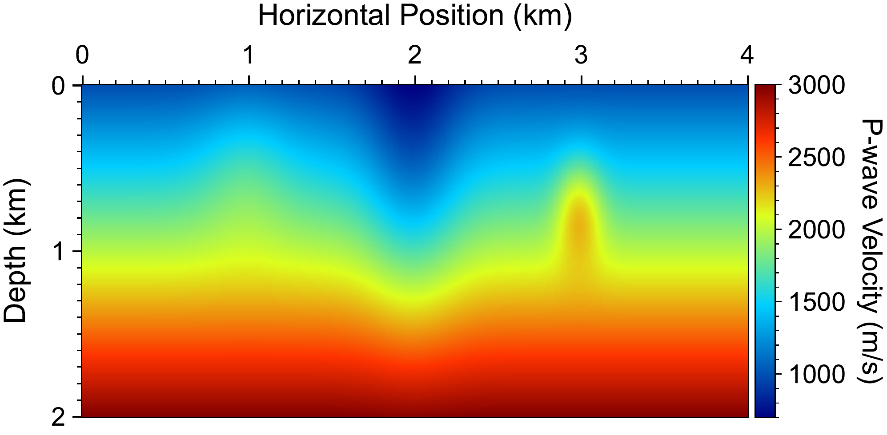
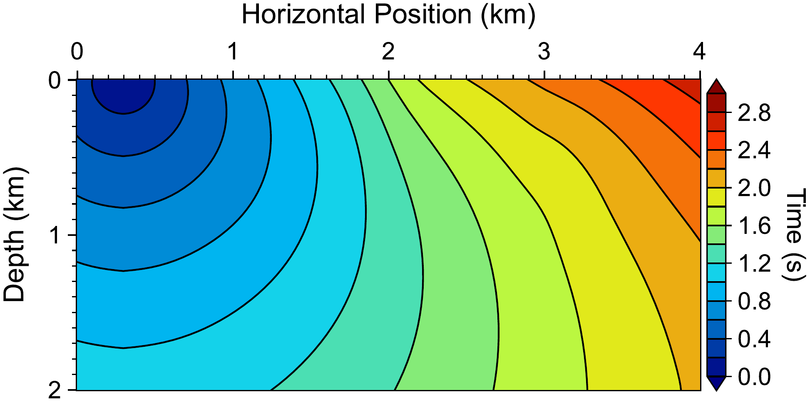
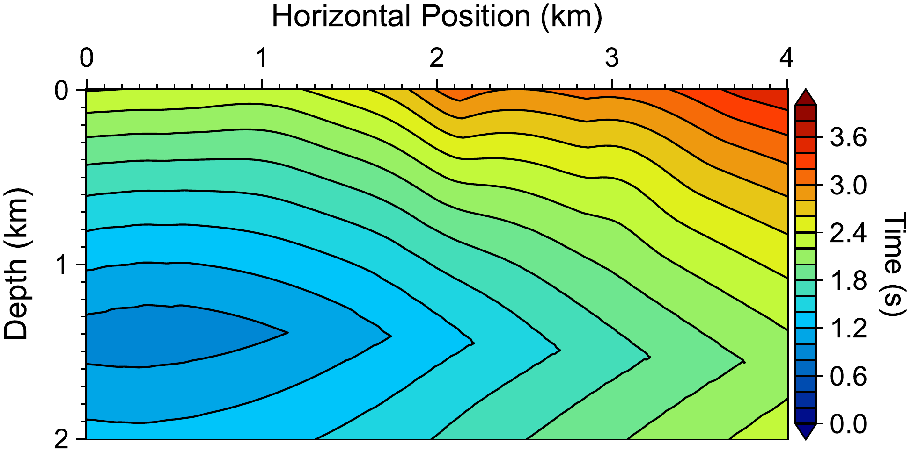
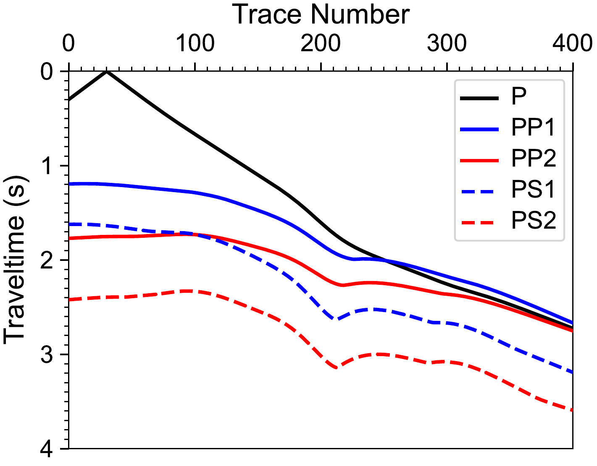
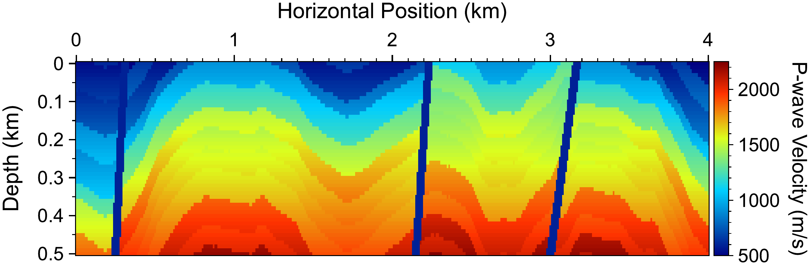
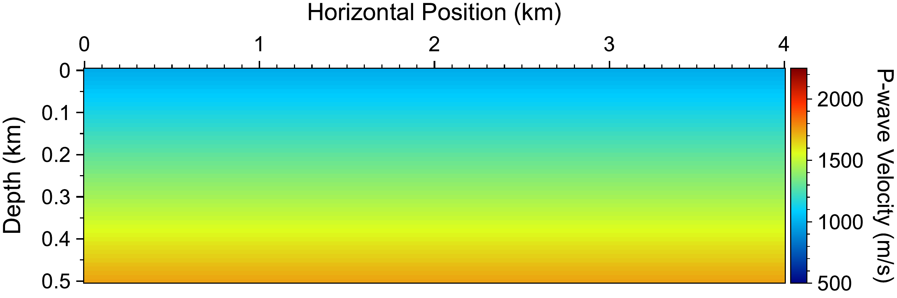
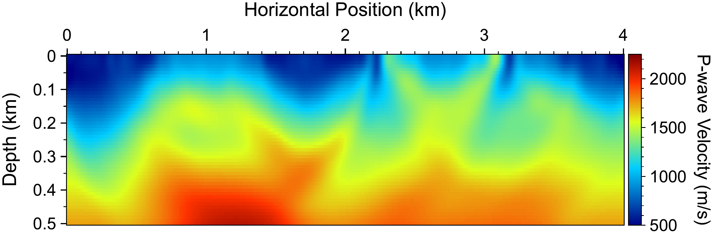
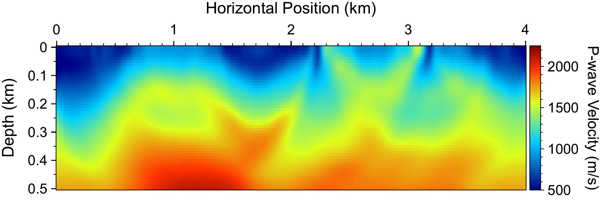
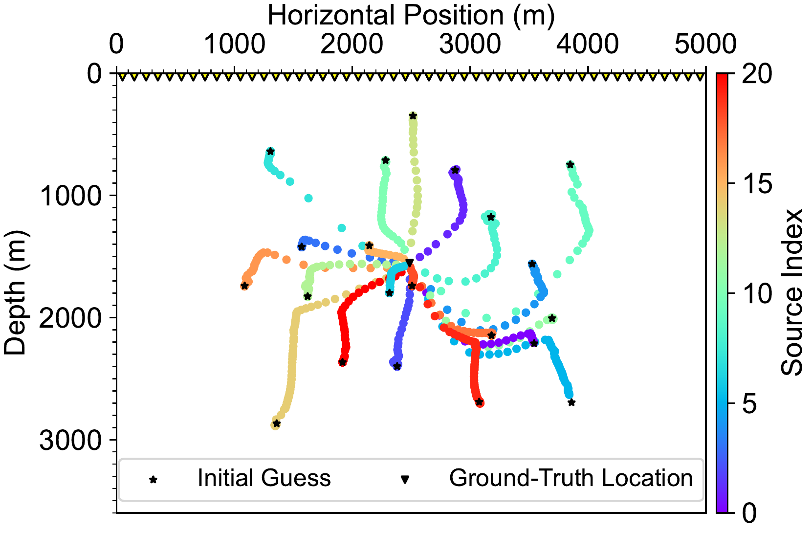
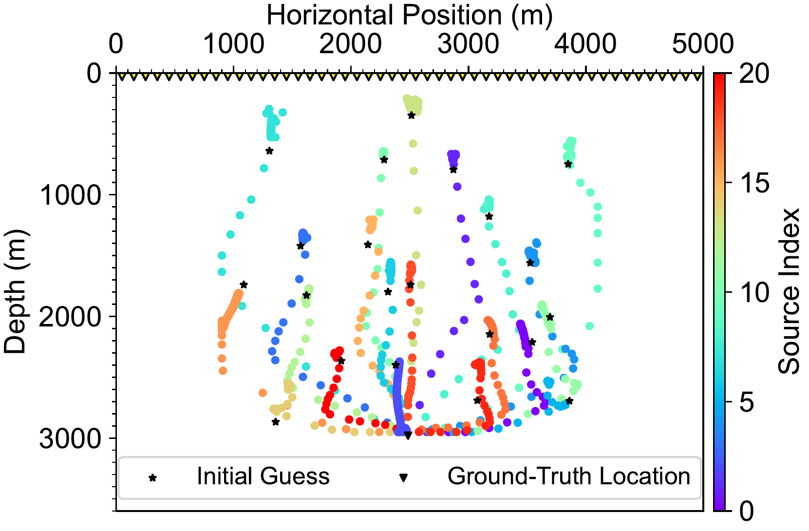

# Description
**LATTE: Los Alamos TravelTime package based on Eikonal equation**

`LATTE` is an open-source software for 
- **Traveltime computation** based on the factorized eikonal equation in 2D/3D acoustic/elastic media for
    - First-arrival P, S traveltimes
    - Both first-arrival and reflection traveltimes (e.g., P, S, PP, SS, PS, SP) for an arbitrary number of reflectors. 
- **Adjoint-state first-arrival traveltime tomography** based on first-arrival traveltime in 2D/3D acoustic/elastic media to 
    - Invert Vp, Vs separately
    - Invert Vp, Vs jointly, optionally with Vp-Vs constraints
    - Use either absolute traveltime difference or differential traveltime difference 
    - Optionally inject the traveltime residuals at receivers between grid points as true adjoint sources, with the transpose of the traveltime interpolation
- **Source location** based on first-arrival traveltime in 2D/3D acoustic/elastic media, including
    - Source location/relocation using P, S, or both P and S traveltimes
    - Joint source location/relocation with first-arrival traveltime tomography using P, S, or both P and S traveltimes
    - Use either absolute traveltime difference or differential traveltime difference 
- **Joint transmission-reflection traveltime tomography** based on first-arrival and reflection traveltimes in 2D/3D acoustic/elastic media to
    - Invert the velocities together with the reflector depths, which are imaged from the reflection traveltimes and refined by least squares in every iteration
    - Optionally image and refine the reflectors with near-offset reflections only, while the velocities use all offsets

Algorithm features (details are explained in [the LATTE paper](https://academic.oup.com/gji/article/241/2/1275/8046728)):

- Written in modern Fortran. 
- Applies to Cartesian, regularly sampled grid. 
- Forward and adjoint-state equations are solved with the fast-sweeping method. 
- Traveltime computation is based on the factorized eikonal equation for avoiding source singularity and thus improved accuracy. 
- Two-level parallelization, including shot parallelization based on MPI and shared-memory parallelization for each shot based on OpenMP. 
- Optional GPU acceleration of 3D traveltime computation and adjoint-state equation solving based on CUDA, with results identical to those on the CPU. 
- Various inversion schemes, including 
    - SD: steepest descent
    - NCG: nonlinear conjugate gradient
    - _l_-BFGS: limited-memory Broyden-Fletcher-Goldfarb-Shanno
- Various regularization schemes, including 
    - TV: total variation regularization for medium parameters
    - TGpV: total generalized _p_-variation regularization for medium parameters
    - smooth: Tikhonov-like smoothing regularization for medium parameters
    - ML: machine-learning-based regularization for source location parameters
- User-friendly parameter setting based on [FLIT](https://github.com/lanl/flit) flexible parameter input functionality. 

`LATTE` does not yet support:
- Curvilinear or unstructured mesh. 
- Medium anisotropy.

The work is supported by Los Alamos National Laboratory (LANL) Laboratory Directed Research and Development (LDRD) project 20240322ER. LANL is operated by Triad National Security, LLC, for the National Nuclear Security Administration (NNSA) of the U.S. Department of Energy (DOE) under Contract No. 89233218CNA000001. The research uses high-performance computing resources provided by LANL's Institutional Computing (IC) program. The paper associated with the work is approved for public release under LA-UR-24-27806. 

The codes are released under LANL open source approval reference O4770.

# Requirement
 - Platform: Linux
 - Compiler: [Intel's oneAPI HPC Toolkit](https://www.intel.com/content/www/us/en/developer/tools/oneapi/hpc-toolkit-download.html)
 - Optional: [NVIDIA's CUDA Toolkit](https://developer.nvidia.com/cuda-toolkit) for the GPU version of the 3D solvers
 - [FLIT](https://github.com/lanl/flit)
 - Some examples in [example](example) require [RGM](https://github.com/lanl/rgm) for model generation and [pymplot](https://github.com/lanl/pymplot) for visualization. 

# Build
`LATTE` compiles with `make`, which [install.rb](src/install.rb) runs for the 2D and the 3D executables. To build the CPU executables:
```
cd src
ruby install.rb
```
This makes `x_eikonal2`, `x_fatt2`, `x_trtt2` and `x_tloc2` for 2D, and `x_eikonal3`, `x_fatt3`, `x_trtt3` and `x_tloc3` for 3D, in `bin`. `install.rb` compiles 2D and 3D at the same time in the background and returns at once, so wait until both finish. The objects go to `$HOME/bin/obj/latte2` and `$HOME/bin/obj/latte3`.

To also build the CUDA versions of the 3D executables:
```
cd src
ruby install.rb clean use_cuda=on
```
This adds `x_eikonal3_cuda`, `x_fatt3_cuda`, `x_trtt3_cuda` and `x_tloc3_cuda` to `bin`. They solve the eikonal and adjoint-state equations on GPUs and give the same results as the CPU executables, which stay unchanged. Their objects go to `$HOME/bin/obj/latte3_cuda`.

`install.rb` passes each argument `name=value` to `make`, which overrides the variable `name` in the Makefiles:

| Option | Description | Default |
|---|---|---|
| `flitdir` | Path to `FLIT` | `$HOME/src/flit` |
| `use_cuda` | `on` also builds the CUDA executables | `off` |
| `cuda_arch` | GPU architecture, e.g., `sm_80` or `sm_90` (`nvcc --list-gpu-arch` lists the values); `native` targets the GPU of the build machine | `native` |
| `cuda_ccbin` | Host compiler of `nvcc`, e.g., `g++-12`, when `nvcc` does not support the default one | none |
| `nvcc` | CUDA compiler | `nvcc` |
| `cuda_home` | CUDA Toolkit directory whose `lib64` holds the CUDA runtime library | The parent of the directory of `nvcc` |

For example, `ruby install.rb clean use_cuda=on cuda_arch=sm_80` builds the CUDA executables for GPUs of the architecture `sm_80`. The argument `clean` removes the old objects and executables first. Use it to rebuild from scratch and whenever an option changes, because `make` does not recompile the objects after an option change. [src](src/README.md) describes further build options.

# Use
Each executable reads a parameter file, and [doc/parameters.md](doc/parameters.md) describes the parameters. For example,
```
mpirun -np 4 bin/x_fatt3 param_fatt.rb
mpirun -np 4 bin/x_fatt3_cuda param_fatt.rb
```
runs 3D FATT on the CPU and on GPUs with the same parameter file. Each MPI rank of a CUDA executable uses GPU `r mod n`, where `r` is the rank's index on its node and `n` is the number of GPUs.

To run [example](example):
```
cd example
```
and the subfolders contain the scripts of the examples, including those of the paper. The [test](test) directory holds tests of the 3D fast sweeps, of the CUDA executables against the CPU ones, and of the two treatments of the traveltime residuals at receivers between grid points. 

# License
&copy; 2024-2026. Triad National Security, LLC. All rights reserved. 

This program is Open-Source under the BSD-3 License.

Redistribution and use in source and binary forms, with or without modification, are permitted provided that the following conditions are met:

- Redistributions of source code must retain the above copyright notice, this list of conditions and the following disclaimer.
 
- Redistributions in binary form must reproduce the above copyright notice, this list of conditions and the following disclaimer in the documentation and/or other materials provided with the distribution.
 
- Neither the name of the copyright holder nor the names of its contributors may be used to endorse or promote products derived from this software without specific prior written permission.

THIS SOFTWARE IS PROVIDED BY THE COPYRIGHT HOLDERS AND CONTRIBUTORS "AS IS" AND ANY EXPRESS OR IMPLIED WARRANTIES, INCLUDING, BUT NOT LIMITED TO, THE IMPLIED WARRANTIES OF MERCHANTABILITY AND FITNESS FOR A PARTICULAR PURPOSE ARE DISCLAIMED. IN NO EVENT SHALL THE COPYRIGHT HOLDER OR CONTRIBUTORS BE LIABLE FOR ANY DIRECT, INDIRECT, INCIDENTAL, SPECIAL, EXEMPLARY, OR CONSEQUENTIAL DAMAGES (INCLUDING, BUT NOT LIMITED TO, PROCUREMENT OF SUBSTITUTE GOODS OR SERVICES; LOSS OF USE, DATA, OR PROFITS; OR BUSINESS INTERRUPTION) HOWEVER CAUSED AND ON ANY THEORY OF LIABILITY, WHETHER IN CONTRACT, STRICT LIABILITY, OR TORT (INCLUDING NEGLIGENCE OR OTHERWISE) ARISING IN ANY WAY OUT OF THE USE OF THIS SOFTWARE, EVEN IF ADVISED OF THE POSSIBILITY OF SUCH DAMAGE.

# Author
Kai Gao, <kaigao@lanl.gov>

We welcome feedback, bug reports, and suggestions for improving `LATTE`. 

If you use this package in your research and find it useful, please cite it as
* Kai Gao, 2024, LATTE: Los Alamos TravelTime package based on Eikonal equation, GitHub Repository, url: [github.com/lanl/latte_traveltime](https://github.com/lanl/latte_traveltime)
* Kai Gao, Ting Chen, 2025, LATTE: open-source, high-performance traveltime computation, tomography and source location in acoustic and elastic media, Geophysical Journal International, doi: [10.1093/gji/ggaf079](https://academic.oup.com/gji/article/241/2/1275/8046728). 

# Examples
Reproducible examples associated with [the LATTE paper](https://academic.oup.com/gji/article/241/2/1275/8046728) are in the `example` directory. Below are some of the figures from the paper. Please refer to the paper for full details. 

<p align="center">
  <br>
  <br>
  <br>
  <br>
</p>
<p align="center"><strong>2D forward modeling. From top to bottom: Vp (Vs is scaled based on Vp), PP traveltime field, PS transmission-reflection traveltime field, P traveltime data. Reflector position plot is not shown here. </strong> </p>

<p align="center">
  <br>
  <br>
  <br>
  <br>
</p>
<p align="center"><strong>2D FATT. From top to bottom: Vp ground truth, Vp initial, Vp by absolute-difference FATT, and Vp by double-difference FATT. </strong> </p>

<p align="center">
  <br>
  <br>
</p>
<p align="center"><strong>2D source location in an elastic medium. Top: source location convergence with known velocity models, and bottom: joint tomography and source location. </strong> </p>
